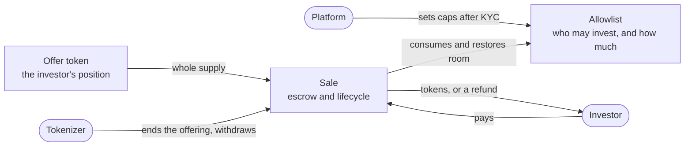
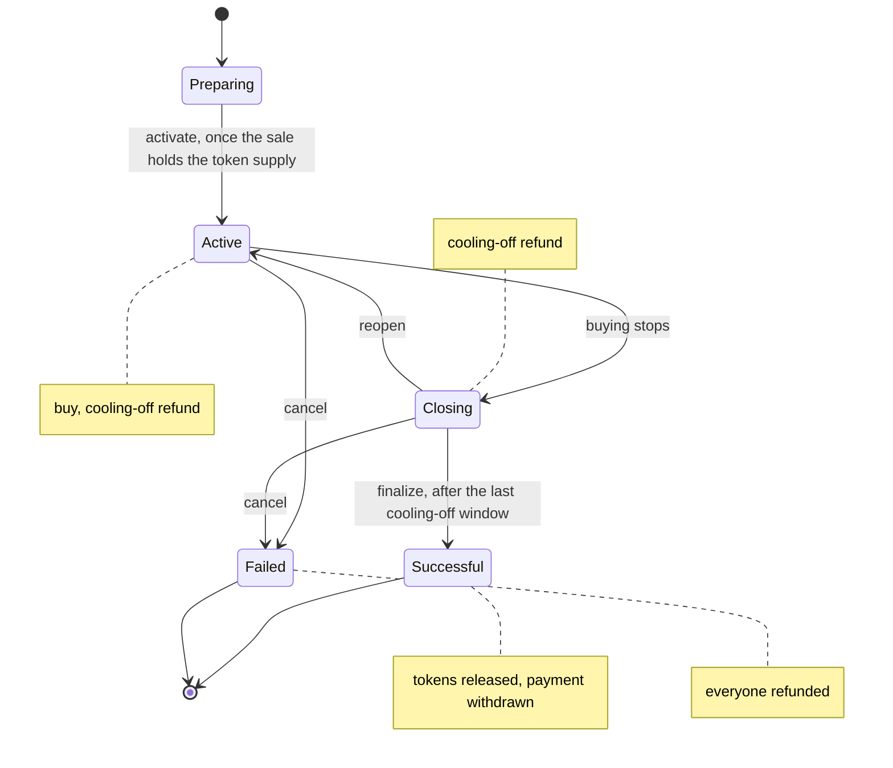

# BWB smart contracts

The on-chain contracts of BWB Digital Assets, a platform that tokenizes real
estate offerings. One protocol, implemented on two chains: Stellar and Base.

A tokenizer opens an offering, investors the platform has approved buy its
tokens, and the money stays in escrow until the offering ends. If it succeeds,
investors get their tokens and the tokenizer gets the money. If it fails,
everyone is refunded.

## How an offering works

Three contracts run every offering. The token and the sale are deployed once
per offering; the allowlist is one global instance, shared by all of them.



- **Offer token:** the investor's position in one offering. A transfer needs
  an approved address on one side (the sale, a distributor), so investors do
  not trade it among themselves. It can be paused.
- **Allowlist:** who may invest and up to how much. A purchase consumes room;
  a refund gives it back.
- **Sale:** holds the offering's tokens and the investors' money, and decides
  where both go when the offering ends.

After a successful offering, **distributors** pay income to the token holders.

## Sale lifecycle

The lifecycle the protocol is designed around:



Buying stops when the tokenizer closes the offering or the last token sells.
The offering then waits in Closing until no purchase can be undone any more,
and only then becomes Successful. Each chain's documentation describes what
its contracts implement today.

Two rules hold on both chains:

- **Minimum to succeed.** An offering only succeeds with a minimum share of
  its tokens sold.
- **Cooling-off.** An investor may undo a purchase and get the money back
  within a fixed window after buying (five days in BWB's offerings).

## The same contracts on both chains

| Role | Stellar (`stellar/contracts/`) | Base (`base/src/`) |
|---|---|---|
| Offer token | [`offer-token`](stellar/docs/offer-token.md) | `OfferERC20` |
| Allowlist | [`offer-allowlist`](stellar/docs/offer-allowlist.md) | `OfferSaleAllowlist` |
| Sale | [`offer-sale`](stellar/docs/offer-sale.md) | `OfferTokenSale` |
| Distributors | in progress | `TokenDistributor`, `TokenDistributorByHoldings` |
| Factories | planned | `OfferTokenFactory`, `OfferTokenSaleFactory`, `TokenDistributorFactory`, `TokenDistributorByHoldingsFactory` |

The Stellar contracts are a port of the Base ones. Where they differ:

- **Allowlist periods.** On Stellar an investor's usage is counted per
  calendar month and starts from zero by itself. On Base the platform resets
  it.
- **Payment asset.** Base offerings are paid in BRLA. Stellar offerings accept
  the asset chosen at deploy, USDC in BWB's offerings.

Each Stellar contract's document describes its differences from Base in detail.

## Repository layout

| Folder | Chain | Stack | What is inside |
|---|---|---|---|
| [`stellar/`](stellar/README.md) | Stellar | Soroban, Rust | The contracts, the TypeScript SDK, deploy scripts and per-network manifests, the event indexer |
| [`base/`](base/README.md) | Base (EVM) | Solidity, Foundry | The contracts with their factories, deploy scripts and broadcast records |
| `docs/scf/` | | | Stellar Community Fund submission and evidence |

Each chain folder is a self-contained project: build, test and deploy from
inside it. Its README has the addresses, the deploy guide and the details.

## Build and test

```bash
(cd stellar && scripts/test.sh)   # Stellar: build fixtures, run the tests
(cd base && forge test)           # Base: run the tests
```

`base/lib/` holds the Foundry libraries as git submodules. Clone with
`--recurse-submodules`, or run `git submodule update --init --recursive` once.

Continuous integration runs three workflows:

| Workflow | Runs |
|---|---|
| [`contracts`](.github/workflows/contracts.yml) | Stellar: format, tests, clippy, WASM build |
| [`sdk`](.github/workflows/sdk.yml) | Stellar SDK: typecheck, build, tests |
| [`base`](.github/workflows/base.yml) | Base: tests, per-file coverage gate, OpenZeppelin upgrade validation |

## License

[Apache 2.0](LICENSE).
