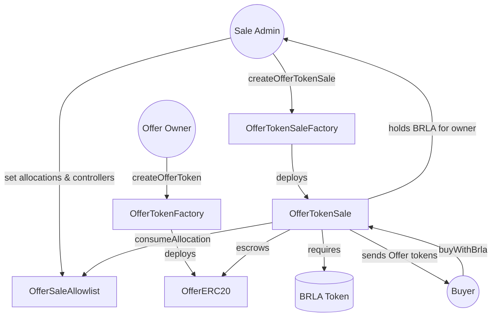
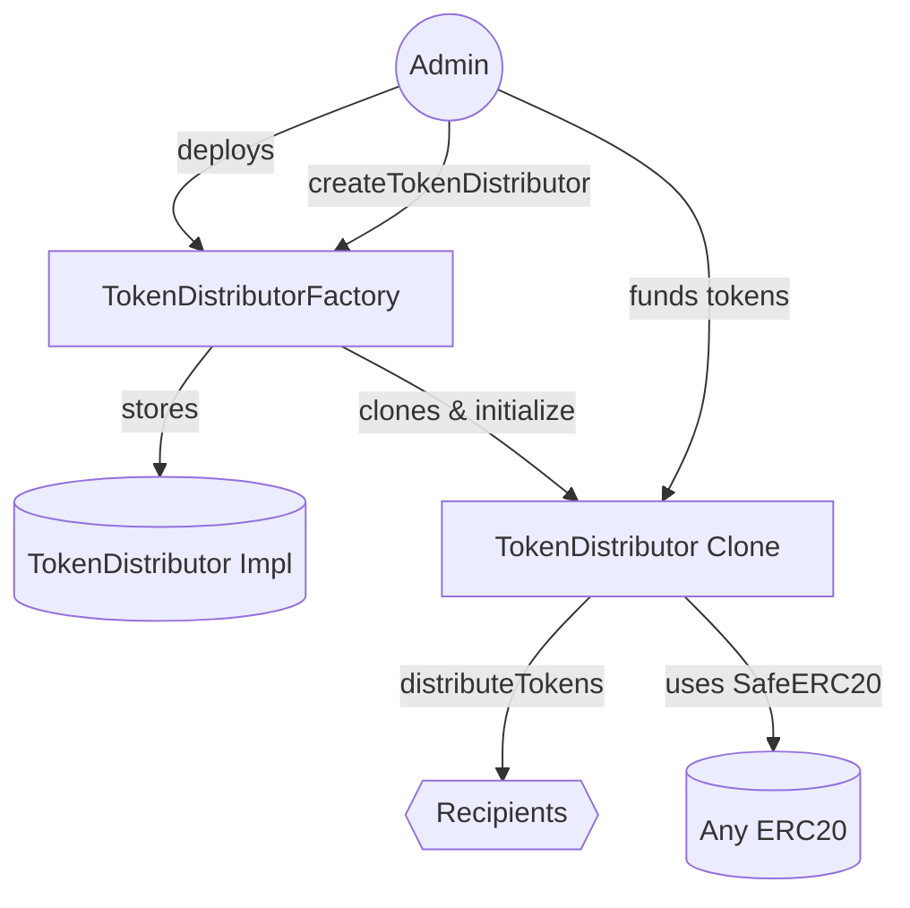

## Table of Contents

- [Overview](#overview)
- [Development Environment (nix-shell)](#development-environment-nix-shell)
- [Local Blockchain (Anvil)](#local-blockchain-anvil)
- [Running Scripts (npm)](#running-scripts-npm)
- [Usage](#usage)
- [Running Tests](#running-tests)
- [Build](#build)
- [Test](#test)
- [Format](#format)
- [Gas Snapshots](#gas-snapshots)
- [Deploy](#deploy)
- [Deploy to Base Sepolia](#deploy-to-base-sepolia)
- [Deploy to Stellar testnet](#deploy-to-stellar-testnet)
- [Cast](#cast)
- [Help](#help)

## Foundry

**Foundry is a blazing fast, portable and modular toolkit for Ethereum application development written in Rust.**

Foundry consists of:

- **Forge**: Ethereum testing framework (like Truffle, Hardhat and DappTools).
- **Cast**: Swiss army knife for interacting with EVM smart contracts, sending transactions and getting chain data.
- **Anvil**: Local Ethereum node, akin to Ganache, Hardhat Network.
- **Chisel**: Fast, utilitarian, and verbose solidity REPL.

## Overview

This repository implements a token distribution system on the Ethereum blockchain. It allows for the distribution of ERC20 tokens (like USDC) to multiple addresses in a single transaction. The core functionality is encapsulated in the `TokenDistributor` contract, which can be interacted with via the provided TypeScript script.

### Contract Interaction Diagrams

#### Offer Issuance & Sale Flow


#### Token Distribution Flow


## Documentation

https://book.getfoundry.sh/

### Usage

Quick start:

1. Open a nix shell (see Development Environment (nix-shell)).
2. In another terminal, start a local chain with Anvil (see [Local Blockchain (Anvil)](#local-blockchain-anvil)).
3. Install dependencies: `npm install`
4. Build contracts and TS: `forge build && npm run build`
5. Run a script with npm: `npm start` or `npm run distribute:usdc`
6. Check `package.json` for scripts to run against the running anvil instance

### Development Environment (nix-shell)

Run `nix-shell` inside this folder to enter a dev environment with Foundry (forge/anvil), Node.js, and TypeScript tooling available on PATH.

### Running Scripts (npm)

To run the TypeScript distribution script, copy `.env.example` to `.env` in this folder and set required values (e.g., `PROVIDER_URL`, `MNEMONIC`). Then compile and run as follows:

1. \*\*Run the local blockchain:

   ```bash
   npm run anvil
   ```

2. **Run the distribution simulation script**:
   ```bash
   npm run distribute:usdc
   ```

#### Export deployment payloads for Safe CLI

Run `forge build` and then this helper to emit `out/deploy/<network>` JSON describing creation bytecode, constructor arguments, and proxy initializer calldata for the Safe-focused admin layer.

```bash
npm run export-deploy-artifacts -- --network base --manifest configs/deployment-summary-<CHAIN_ID>.json
```

Provide `SAFE_ADDRESS` (and optionally `TRANSFER_ADMIN_ADDRESS`) so the script can populate owner placeholders, and pass a manifest to resolve implementation addresses that already exist.

### Deploy SafeAddressRegistry

Use the Foundry script to deploy the registry, defaulting the owner to the broadcasting account or the `GNOSIS_SAFE_ADDRESS` env var if provided.

```bash
forge script script/DeploySafeAddressRegistry.s.sol:DeploySafeAddressRegistry \
  --rpc-url $RPC_URL \
  --broadcast \
  --account deployer   # or --private-key/--mnemonic
```

Set `GNOSIS_SAFE_ADDRESS=0xYourSafeAddress` before running if the registry should be owned by an existing Safe.

### Running Foundry scripts

See `docs/full-deployment-helper.md` for the full deployment helper guide (testnet + mainnet flows, Foundry scripts, and shell helpers).

### Running Tests

Tests are implemented using Foundry. You can execute the tests for the `TokenDistributor` contract with the following command:

```bash
forge test --verbosity 2
```

### Build

```shell $ forge build

```

### Test

```shell
$ forge test
```

### Format

```shell
$ forge fmt
```

### Gas Snapshots

```shell
$ forge snapshot
```

### Local Blockchain (Anvil)

Run this in a separate terminal before running scripts; it starts a local Ethereum node configured as:

```shell
anvil \
  --mnemonic "test test test test test test test test test test test junk" \
  --derivation-path "m/44'/60'/0'/0/" \
  --accounts 10 \
  --balance 10000 \
  --chain-id 31337 \
  --timestamp 1700000000 \
  --gas-limit 30000000 \
  --base-fee 0 \
  --host 127.0.0.1 \
  --port 8545
```

### Deploy

```shell
$ forge script script/Counter.s.sol:CounterScript --rpc-url <your_rpc_url> --account <your_private_key>
```

### Deploy to Base Sepolia

Run every step from `contracts/`.

1. Install `forge`, `cast` and `jq`.
2. Check the deployer keystore:

   ```shell
   cast wallet address --account deployer
   ```

   It must print `0xe3066D77C49efa83af1CEfDCcc9882f10B70B700`. If the keystore is missing, import it with `cast wallet import deployer --interactive`. If it prints another address, stop.

3. Write the settings file, with an etherscan.io API key:

   ```shell
   printf '%s\n' \
     RPC_URL=https://sepolia.base.org \
     CHAIN_ID=84532 \
     DEPLOYER_ADDRESS=0xe3066D77C49efa83af1CEfDCcc9882f10B70B700 \
     BRLA_ADDRESS=0xA8AA3b44Afb4aA219ee12Ca4CE93C2081767BfDb \
     CONTROLLER_ADDRESS=0x13262dD815DDF6baf0558f9d20dc3d2F879e7902 \
     ETHERSCAN_API_KEY=REPLACE_WITH_ETHERSCAN_IO_KEY \
     > .env.base-sepolia
   ```

   Never copy or source `.env.staging`, and check that `env | grep _ADDRESS` prints nothing: a set factory or allowlist address skips that deploy and the record inherits the stale address.

4. Estimate the cost:

   ```shell
   ./deploy-wizard.sh base-sepolia --simulate
   ```

   If the deployer balance is below the estimate, fund it from the [Alchemy](https://www.alchemy.com/faucets/base-sepolia) or ETHGlobal Base Sepolia faucet.

5. Deploy:

   ```shell
   ./deploy-wizard.sh base-sepolia
   ```

   Answer `y` to "Proceed with deployment?" and enter the keystore password at each prompt (about 11).

6. The wizard writes `configs/deployment-base-sepolia.json`. Check it and commit it with the broadcast records:

   ```shell
   jq -e '.chainId == "84532"' configs/deployment-base-sepolia.json
   git add configs/deployment-base-sepolia.json broadcast/base-sepolia
   ```

The wizard's controller step grants `CONTROLLER_ADDRESS` controller on OfferTokenFactory, OfferTokenSaleFactory, TokenDistributorFactory, TokenDistributorByHoldingsFactory and OfferSaleAllowlist.

#### Redeploy the sale factory for short cooling-off windows

The sale factory accepts a cooling-off period of one minute or more; the Base Sepolia factory deployed before that change still refuses anything under a day. The sale implementation is unchanged, so only the factory is redeployed:

1. Remove the previous record, so the wizard deploys the factory instead of reusing it, and leave `OFFER_TOKEN_SALE_FACTORY_ADDRESS` out of `.env.base-sepolia`:

   ```shell
   git rm broadcast/base-sepolia/DeployOfferTokenSaleFactory.s.sol/84532/run-latest.json
   ```

2. Run the wizard. It reuses every other contract, deploys the sale factory and grants the controller on it:

   ```shell
   ./deploy-wizard.sh base-sepolia
   ```

3. Point each testnet backend deployment at the new factory, and set the period sales are created with (300 seconds is five minutes), from `app/`:

   ```shell
   bunx convex env set OFFER_TOKEN_SALE_FACTORY_ADDRESS <new factory address>
   bunx convex env set SALE_COOLING_OFF_SECONDS 300
   ```

   Without `SALE_COOLING_OFF_SECONDS` a sale gets the contract's five-day default. Sales created earlier keep the period they were created with.

#### Grant the controller where the holdings factory already exists

The Base Sepolia TokenDistributorByHoldingsFactory (`0xFF4EA4e06a4659217601a8E42dbA86B320FaeBad`) predates its controller grant. Grant it once, without redeploying:

1. Grant the controller on all five contracts, answer `y` and enter the keystore password:

   ```shell
   ./shells/manage-controller.sh base-sepolia grant 0x13262dD815DDF6baf0558f9d20dc3d2F879e7902
   ```

   The status table it prints must show `true` on every row.

2. Point the backend deployment at the factory, from `app/`:

   ```shell
   bunx convex env set TOKEN_DISTRIBUTOR_BY_HOLDINGS_FACTORY_ADDRESS 0xFF4EA4e06a4659217601a8E42dbA86B320FaeBad
   ```

### Deploy to Stellar testnet

The Stellar contracts live next to this folder, in [`stellar/`](../stellar/README.md). Setting up a testnet backend deployment for them is documented in the backend repository.

### Cast

```shell
$ cast <subcommand>
```

### Help

```shell
$ forge --help
$ anvil --help
$ cast --help
```

## Processo completo onchain na versão atual

O fluxo completo ficou assim:

> NOTE QUE: o back-end precisa lidar com esse processo à sua maneira, esse processo aqui ilustra o fluxo completo seguindo o que é possível ser feito na arquitetura dos contratos e com scripts para automação

Na primeira parte, os endereços de contrato da BASE Testnet (Base Sepolia) estão em `configs/deployment-base-sepolia.json`.

> NOTE QUE: na Base Sepolia, o `brlaToken` é o BRLA de sandbox da Avenia, e não um mock. Em mainnet ele é o BRLA real e funciona igual.

Allocations precisam ser configuradas para permitir que carteiras possam interagir com os contratos. É por isso que o `full-deplo.sh` tem essa parte:

```
==> Configuring OfferSaleAllowlist allocations

```

Esses são os endereços de carteira que estão sendo usadas para interagir com os contratos:

```
==> Environment configuration
  Alias        Value
  deployer     (unset)
  advisor      0xD952aF32b9a85872cBA2207129dAe6d3aE43F0d5
  investor1    0xD7003f68C413E05F75DbC29b04DE913AF9ba88aB
  investor2    0x22a4995ff565A2758Dbec9897FE1B664AfAD8B1c
  investor3    0x2eaBaC745Cfe29986CeB0C8acfa9407900cA5376

==> Account addresses derived from keystores
  Alias        Keystore address
  deployer     0xe248874BD1f07F9B732c9970bF1BF51bd8AE5963
  advisor      0xD952aF32b9a85872cBA2207129dAe6d3aE43F0d5
  investor1    0xD7003f68C413E05F75DbC29b04DE913AF9ba88aB
  investor2    0x22a4995ff565A2758Dbec9897FE1B664AfAD8B1c
  investor3    0x2eaBaC745Cfe29986CeB0C8acfa9407900cA5376

```

Esses endereços acima simulam:

- deployer: a carteira do back-end que é responsável por lidar com funções de release dos contratos, sendo o `owner` dos contratos;
- advisor: a carteira do criador das ofertas. Simula a função de quem gerencia os investimentos;
- investor1,2,3: A carteira do investidor, pessoa física querendo adquirir tokens de ofertas.

Com esses endereços, as interações com o contrato se seguem da seguinte maneira:

1. Primeiro, todos os contratos precisam receber fundos para testar essa lógica. Então, no lado dos contratos roda: `run_fund_accounts() ` de dentro do shellscrilt do `full-deploy.sh`. À partir daqui, todas os endereços citados anteriormente possuem uma fração suficiente de ETH para gás e de BRL para adquirir ofertas. **Em produção, na BASE mainnet, assume-se que os usuários tenham o BRL para comprar e que o ETH está ou sendo funded pelo provedor de carteira**

2. Em seguida, com cada endereço estando "funded", tem que rodar o script `deployOfferERC20`. Isso aqui cria tokens de ofertas para a próxima etapa.

3. Nessa etapa, os tokens de ofertas precisam ser ofertados em um contrato do tipo `OfferTokenSale.sol`. Aqui, então, precisa ser usado o script `DeployOfferTokenSale` para o deploy desse contrato:

```
[nix-shell:base/shells]$  ./create-offer-token.sh --name "Tower One" --symbol TOWER --supply 120 --offer-uri https://example.com/offers/tower.json
Using deployment summary: base/configs/deployment-base-sepolia.json
Resolved OfferTokenFactory from base/configs/deployment-base-sepolia.json: <endereço OfferTokenFactory>

==> Preparing OfferERC20 deployment
Token name:    Tower One
Token symbol:  TOWER
Initial supply: 120
Offer URI:     https://example.com/offers/tower.json
Owner:         (deployer fallback)
Factory:       <endereço OfferTokenFactory>

==> Running DeployOfferERC20 script
[⠊] Compiling...
No files changed, compilation skipped
Warning: Detected artifacts built from source files that no longer exist. Run `forge clean` to make sure builds are in sync with project files.
 - base/script/DeplorOfferERC20.s.sol
 - base/src/OfferERC6909.sol
Enter keystore password:
Script ran successfully.

== Return ==
token: contract OfferERC20 0x38F7C324078527af3bbDa1c287fb42501B088Ec0

== Logs ==
  OfferERC20 deployed at: 0x38F7C324078527af3bbDa1c287fb42501B088Ec0
  Factory used: <endereço OfferTokenFactory>
  Owner receiving supply: 0xe248874BD1f07F9B732c9970bF1BF51bd8AE5963
  Offer URI: https://example.com/offers/tower.json

## Setting up 1 EVM.

==========================

Chain 84532

Estimated gas price: 0.0014 gwei

Estimated total gas used for script: 1857880

Estimated amount required: 0.000002601032 ETH

==========================

##### base-sepolia
✅  [Success] Hash: 0xc21e780c75e0d12e5e1a76bf2efd16fb24fcf458fed152344945f5b929fb9e2d
Block: 37225889
Paid: 0.0000016140864 ETH (1345072 gas * 0.0012 gwei)

✅ Sequence #1 on base-sepolia | Total Paid: 0.0000016140864 ETH (1345072 gas * avg 0.0012 gwei)


==========================

ONCHAIN EXECUTION COMPLETE & SUCCESSFUL.

Transactions saved to: base/broadcast/DeployOfferERC20.s.sol/84532/run-latest.json

Sensitive values saved to: base/cache/DeployOfferERC20.s.sol/84532/run-latest.json


==> OfferERC20 deployment complete
Factory used:   <endereço OfferTokenFactory>
Token details:  Tower One (TOWER)
Offer URI:      https://example.com/offers/tower.json

```

Esse script acima vai usar os endereços previamente configurados sempre.

5. , colocando o `totalSupply` do token criado completamente à venda:

```
[nix-shell:base/shells]$ ./create-offer-token-sale.sh --offer-token 0x38F7C324078527af3bbDa1c2
87fb42501B088Ec0 --price 1000000000000000000
Using deployment summary: base/configs/deployment-base-sepolia.json
Resolved OfferTokenSaleFactory from config: <endereço OfferTokenSaleFactory>
Resolved OfferSaleAllowlist from config: <endereço OfferSaleAllowlist>
Resolved BRLA token from config: <endereço BRLA>
Defaulting sale owner to DEPLOYER_ADDRESS: 0xe248874BD1f07F9B732c9970bF1BF51bd8AE5963

==> Preparing OfferTokenSale deployment
Offer token:   0x38F7C324078527af3bbDa1c287fb42501B088Ec0
BRLA token:    <endereço BRLA>
Allowlist:     <endereço OfferSaleAllowlist>
Price (wei):   1000000000000000000
Sale owner:    0xe248874BD1f07F9B732c9970bF1BF51bd8AE5963
Inventory provider: resolving after deployment
Inventory approval signer: deployer
Factory:       <endereço OfferTokenSaleFactory>
Signer alias:  deployer

==> Running DeployOfferTokenSale script
[⠊] Compiling...
No files changed, compilation skipped
Enter keystore password:
Script ran successfully.

== Return ==
sale: contract OfferTokenSale 0x315B3f89D9D755cB02B348CC5AB320de088b3b9f

== Logs ==
  OfferTokenSale deployed at: 0x315B3f89D9D755cB02B348CC5AB320de088b3b9f
  Factory used: <endereço OfferTokenSaleFactory>
  Offer token: 0x38F7C324078527af3bbDa1c287fb42501B088Ec0
  BRLA token: <endereço BRLA>
  BRLA per token (1e18): 1000000000000000000
  Allowlist: <endereço OfferSaleAllowlist>
  Sale owner: 0xe248874BD1f07F9B732c9970bF1BF51bd8AE5963

## Setting up 1 EVM.

==========================

Chain 84532

Estimated gas price: 0.0014 gwei

Estimated total gas used for script: 3267888

Estimated amount required: 0.0000045750432 ETH

==========================

##### base-sepolia
✅  [Success] Hash: 0xdca4fedcab45ea7bd61c6b5aea7fde5e3eccba282bf49ec04bc2f753be9a25e0
Block: 37227164
Paid: 0.0000028390704 ETH (2365892 gas * 0.0012 gwei)

✅ Sequence #1 on base-sepolia | Total Paid: 0.0000028390704 ETH (2365892 gas * avg 0.0012 gwei)


==========================

ONCHAIN EXECUTION COMPLETE & SUCCESSFUL.

Transactions saved to: base/broadcast/DeployOfferTokenSale.s.sol/84532/run-latest.js
on

Sensitive values saved to: base/cache/DeployOfferTokenSale.s.sol/84532/run-latest.js
on

Detected inventory provider from OfferTokenSale.inventoryProvider(): 0xe248874BD1f07F9B732c9970bF1BF51bd8AE5963
\nSale deployed at: 0x315B3f89D9D755cB02B348CC5AB320de088b3b9f
Inventory provider: 0xe248874BD1f07F9B732c9970bF1BF51bd8AE5963
Inventory signer: deployer

==> Preparing inventory approval
Total supply detected: 120
[⠊] Compiling...
[⠔] Compiling 1 files with Solc 0.8.28
[⠒] Solc 0.8.28 finished in 456.85ms
Compiler run successful with warnings:
Warning (2018): Function state mutability can be restricted to pure
  --> src/OfferERC20.sol:29:5:
   |
29 |     function decimals() public view override returns (uint8) {
   |     ^ (Relevant source part starts here and spans across multiple lines).

Enter keystore password:
Script ran successfully.

== Logs ==
  Approved OfferTokenSale to spend 120 tokens
  Sale address: 0x315B3f89D9D755cB02B348CC5AB320de088b3b9f

## Setting up 1 EVM.

==========================

Chain 84532

Estimated gas price: 0.0014 gwei

Estimated total gas used for script: 68577

Estimated amount required: 0.0000000960078 ETH

==========================

##### base-sepolia
✅  [Success] Hash: 0xca835003f67ce8a53b13e0aa3c5bf6b7fd00ec7825bd11850f243223df265c3c
Block: 37227175
Paid: 0.0000000562692 ETH (46891 gas * 0.0012 gwei)

✅ Sequence #1 on base-sepolia | Total Paid: 0.0000000562692 ETH (46891 gas * avg 0.0012 gwei)


==========================

ONCHAIN EXECUTION COMPLETE & SUCCESSFUL.

Transactions saved to: base/broadcast/ApproveOfferTokenInventory.s.sol/84532/run-lat
est.json

Sensitive values saved to: base/cache/ApproveOfferTokenInventory.s.sol/84532/run-lat
est.json


==> Seeding OfferTokenSale inventory
[⠊] Compiling...
[⠒] Compiling 1 files with Solc 0.8.28
[⠑] Solc 0.8.28 finished in 475.80ms
Compiler run successful with warnings:
Warning (2018): Function state mutability can be restricted to pure
  --> src/OfferERC20.sol:29:5:
   |
29 |     function decimals() public view override returns (uint8) {
   |     ^ (Relevant source part starts here and spans across multiple lines).

Enter keystore password:
Script ran successfully.

== Logs ==
  OfferTokenSale seeded with 120 tokens
  Sale address: 0x315B3f89D9D755cB02B348CC5AB320de088b3b9f
  Inventory provider: 0xe248874BD1f07F9B732c9970bF1BF51bd8AE5963

## Setting up 1 EVM.

==========================

Chain 84532

Estimated gas price: 0.0014 gwei

Estimated total gas used for script: 93978

Estimated amount required: 0.0000001315692 ETH

==========================

##### base-sepolia
✅  [Success] Hash: 0x20f8735867b69f5957ab6e8355f82719212b48199e2733dc9359e3cd833cb8c0
Block: 37227182
Paid: 0.0000000771108 ETH (64259 gas * 0.0012 gwei)

✅ Sequence #1 on base-sepolia | Total Paid: 0.0000000771108 ETH (64259 gas * avg 0.0012 gwei)


==========================

ONCHAIN EXECUTION COMPLETE & SUCCESSFUL.

Transactions saved to: base/broadcast/SeedOfferTokenSale.s.sol/84532/run-latest.json

Sensitive values saved to: base/cache/SeedOfferTokenSale.s.sol/84532/run-latest.json

\nOfferTokenSale ready at 0x315B3f89D9D755cB02B348CC5AB320de088b3b9f

```

Aqui abaixo é um processo completo da compra de tokens por parte dos investidores, e o contrato sendo marcado como finalizado:

```
[nix-shell:base/shells]$ ./buyout-offer-token-sale.sh --sale-address 0xEEB9c4347C2829234F09e7536960b25d97fe01BD
Using OfferTokenSale: 0xEEB9c4347C2829234F09e7536960b25d97fe01BD

==> OfferTokenSale snapshot
Sale address: 0xEEB9c4347C2829234F09e7536960b25d97fe01BD
Total tokens for sale: 120
Sold tokens: 0
Remaining tokens: 120
BRLA per token: 1000000000000000000 wei (1 BRLA)
Inventory seeded: true
Sale finalized: false

BRLA balance summary
  Deployer (0xe248874BD1f07F9B732c9970bF1BF51bd8AE5963): 2999999400000000000000000000 wei (2999999400 BRLA)
  Investors:
    investor1 (0xD7003f68C413E05F75DbC29b04DE913AF9ba88aB): 200000000000000000000 wei (200 BRLA)
    investor2 (0x22a4995ff565A2758Dbec9897FE1B664AfAD8B1c): 200000000000000000000 wei (200 BRLA)
    investor3 (0x2eaBaC745Cfe29986CeB0C8acfa9407900cA5376): 200000000000000000000 wei (200 BRLA)

Purchase plan (alias : tokens : BRLA)
  investor1  40           40000000000000000000 wei (40 BRLA)
  investor2  40           40000000000000000000 wei (40 BRLA)
  investor3  40           40000000000000000000 wei (40 BRLA)

==> Buying 40 tokens using investor1
[⠊] Compiling...
No files changed, compilation skipped
Script ran successfully.

== Return ==
tokensBought: uint256 40

== Logs ==
  Preparing purchase via OfferTokenSale: 0xEEB9c4347C2829234F09e7536960b25d97fe01BD
  BRLA token address: <endereço BRLA>
  Offer token address: 0xd0E0549087849d020Fd28E141478F0E7b7804F02
  Requested BRLA amount: 40000000000000000000
  Preview offer tokens (before slippage checks): 40
  Buyer address: 0xD7003f68C413E05F75DbC29b04DE913AF9ba88aB
  Buyer BRLA balance: 200000000000000000000
  OfferTokenSale: 0xEEB9c4347C2829234F09e7536960b25d97fe01BD
  BRLA spent: 40000000000000000000
  Offer tokens received: 40
  Offer token address: 0xd0E0549087849d020Fd28E141478F0E7b7804F02

## Setting up 1 EVM.

==========================

Chain 84532

Estimated gas price: 0.001405892 gwei

Estimated total gas used for script: 298107

Estimated amount required: 0.000000419106246444 ETH

==========================
Enter keystore password:

##### base-sepolia
✅  [Success] Hash: 0xaad94848f56bebb585839cb962bb66c585bc27219f3129260c4da7943891c786
Block: 37231456
Paid: 0.0000000563556 ETH (46963 gas * 0.0012 gwei)


##### base-sepolia
✅  [Success] Hash: 0xbb01df6449d82ae539cc2e623a3ce9c156c581a5d28132b552b6c0a52e26fb2b
Block: 37231456
Paid: 0.00000019932 ETH (166100 gas * 0.0012 gwei)

✅ Sequence #1 on base-sepolia | Total Paid: 0.0000002556756 ETH (213063 gas * avg 0.0012 gwei)


==========================

ONCHAIN EXECUTION COMPLETE & SUCCESSFUL.

Transactions saved to: base/broadcast/BuyOfferTokens.s.sol/84532/run-latest.json

Sensitive values saved to: base/cache/BuyOfferTokens.s.sol/84532/run-latest.json


==> Buying 40 tokens using investor2
[⠊] Compiling...
No files changed, compilation skipped
Script ran successfully.

== Return ==
tokensBought: uint256 40

== Logs ==
  Preparing purchase via OfferTokenSale: 0xEEB9c4347C2829234F09e7536960b25d97fe01BD
  BRLA token address: <endereço BRLA>
  Offer token address: 0xd0E0549087849d020Fd28E141478F0E7b7804F02
  Requested BRLA amount: 40000000000000000000
  Preview offer tokens (before slippage checks): 40
  Buyer address: 0x22a4995ff565A2758Dbec9897FE1B664AfAD8B1c
  Buyer BRLA balance: 200000000000000000000
  OfferTokenSale: 0xEEB9c4347C2829234F09e7536960b25d97fe01BD
  BRLA spent: 40000000000000000000
  Offer tokens received: 40
  Offer token address: 0xd0E0549087849d020Fd28E141478F0E7b7804F02

## Setting up 1 EVM.

==========================

Chain 84532

Estimated gas price: 0.0014 gwei

Estimated total gas used for script: 250867

Estimated amount required: 0.0000003512138 ETH

==========================
Enter keystore password:

##### base-sepolia
✅  [Success] Hash: 0xece51a30e36375f4ddabda9b228a3b5caf1eb794e6dc71cd723fdf829402d6ca
Block: 37231461
Paid: 0.0000000563556 ETH (46963 gas * 0.0012 gwei)


##### base-sepolia
✅  [Success] Hash: 0xe8f8b7c14aef154c8bd20463aecb5a9c6f903f863806252b45deb02c95cbd69d
Block: 37231461
Paid: 0.00000015828 ETH (131900 gas * 0.0012 gwei)

✅ Sequence #1 on base-sepolia | Total Paid: 0.0000002146356 ETH (178863 gas * avg 0.0012 gwei)


==========================

ONCHAIN EXECUTION COMPLETE & SUCCESSFUL.

Transactions saved to: base/broadcast/BuyOfferTokens.s.sol/84532/run-latest.json

Sensitive values saved to: base/cache/BuyOfferTokens.s.sol/84532/run-latest.json


==> Buying 40 tokens using investor3
[⠊] Compiling...
No files changed, compilation skipped
Script ran successfully.

== Return ==
tokensBought: uint256 40

== Logs ==
  Preparing purchase via OfferTokenSale: 0xEEB9c4347C2829234F09e7536960b25d97fe01BD
  BRLA token address: <endereço BRLA>
  Offer token address: 0xd0E0549087849d020Fd28E141478F0E7b7804F02
  Requested BRLA amount: 40000000000000000000
  Preview offer tokens (before slippage checks): 40
  Buyer address: 0x2eaBaC745Cfe29986CeB0C8acfa9407900cA5376
  Buyer BRLA balance: 200000000000000000000
  OfferTokenSale: 0xEEB9c4347C2829234F09e7536960b25d97fe01BD
  BRLA spent: 40000000000000000000
  Offer tokens received: 40
  Offer token address: 0xd0E0549087849d020Fd28E141478F0E7b7804F02

## Setting up 1 EVM.

==========================

Chain 84532

Estimated gas price: 0.0014 gwei

Estimated total gas used for script: 250867

Estimated amount required: 0.0000003512138 ETH

==========================
Enter keystore password:

##### base-sepolia
✅  [Success] Hash: 0x8a1b745a581873eced0bd0df5fed4e741ee234f0f23f8a6d2c2e9e36b0d730e2
Block: 37231466
Paid: 0.00000015828 ETH (131900 gas * 0.0012 gwei)


##### base-sepolia
✅  [Success] Hash: 0xc9197568d9c0503c98c588b243c176bf0e360b753c2ae87da1e80ac5c015f435
Block: 37231466
Paid: 0.0000000563556 ETH (46963 gas * 0.0012 gwei)

✅ Sequence #1 on base-sepolia | Total Paid: 0.0000002146356 ETH (178863 gas * avg 0.0012 gwei)


==========================

ONCHAIN EXECUTION COMPLETE & SUCCESSFUL.

Transactions saved to: base/broadcast/BuyOfferTokens.s.sol/84532/run-latest.json

Sensitive values saved to: base/cache/BuyOfferTokens.s.sol/84532/run-latest.json


Post-purchase sold tokens: 120
Post-purchase remaining tokens: 0

==> Finalizing OfferTokenSale via deployer
[⠊] Compiling...
[⠒] Compiling 1 files with Solc 0.8.28
[⠑] Solc 0.8.28 finished in 468.82ms
Compiler run successful!
Enter keystore password:
Script ran successfully.

== Logs ==
  Attempting to finalize OfferTokenSale: 0xEEB9c4347C2829234F09e7536960b25d97fe01BD
  Sold tokens: 120
  Total tokens: 120
  OfferTokenSale finalized: 0xEEB9c4347C2829234F09e7536960b25d97fe01BD

## Setting up 1 EVM.

==========================

Chain 84532

Estimated gas price: 0.00141672 gwei

Estimated total gas used for script: 56535

Estimated amount required: 0.0000000800942652 ETH

==========================

##### base-sepolia
✅  [Success] Hash: 0x685332ee445d2537fa2f12fe202442c3c836fdbd15107f9daa0ebf669ae3364b
Block: 37231473
Paid: 0.000000046722125881 ETH (38657 gas * 0.001208633 gwei)

✅ Sequence #1 on base-sepolia | Total Paid: 0.000000046722125881 ETH (38657 gas * avg 0.001208633 gwei)


==========================

ONCHAIN EXECUTION COMPLETE & SUCCESSFUL.

Transactions saved to: base/broadcast/FinalizeOfferTokenSale.s.sol/84532/run-latest.json

Sensitive values saved to: base/cache/FinalizeOfferTokenSale.s.sol/84532/run-latest.json


OfferTokenSale is fully sold out and finalized.


```

> Observação: seguindo a regra de arrependimento da CVM 88, mesmo após a `OfferTokenSale` ser finalizada com sucesso, cada investidor ainda tem até 5 dias corridos desde seu último aporte para solicitar reembolso via `requestCoolingOffRefund`. O contrato libera o BRLA correspondente (revertendo a alocação) desde que o pedido esteja dentro da janela de 5 dias.

4. Assim que a oferta for finalizada, ou seja, quando todos os tokens forem comprados, ou caso a oferta seja negada , vem a parte do `TokenDistributor.sol`. Esse contrato vai lidar com a parte de receber os fundos daquele contrato de venda, e distribuir os tokens para cada parte. Esse contrato simplesmente recebe **endereços e valores** e ele vai distribuir o BRLA. Os `OfferTokens` podem ser resgatados pelo próprio contrato da `OfferTokenSale` quando a oferta é finalizada.

Na primeira vez, se os tokens da venda forem distribuídos para um endereço apenas, um `TokenDistributor` não é necessário para receber o BRLA do contrato. Por exemplo, abaixo, todos os tokens foram vendidos, enviados os `OfferERC20` depois que a oferta foi finalizada e o `advisor` foi quem recebeu o montante total no seu endereço em BRLA:

```
[nix-shell:base/shells]$ ./buyout-offer-token-sale.sh --sale-address 0xEEB9c4347C2829234F09e7536960b25d97fe01BD
Using OfferTokenSale: 0xEEB9c4347C2829234F09e7536960b25d97fe01BD

==> OfferTokenSale snapshot
Sale address: 0xEEB9c4347C2829234F09e7536960b25d97fe01BD
Total tokens for sale: 120
Sold tokens: 120
Remaining tokens: 0
BRLA per token: 1000000000000000000 wei (1 BRLA)
Inventory seeded: true
Sale finalized: true

BRLA balance summary
  Deployer (0xe248874BD1f07F9B732c9970bF1BF51bd8AE5963): 2999999100000000000000000000 wei (2999999100 BRLA)
  Investors:
    investor1 (0xD7003f68C413E05F75DbC29b04DE913AF9ba88aB): 260000000000000000000 wei (260 BRLA)
    investor2 (0x22a4995ff565A2758Dbec9897FE1B664AfAD8B1c): 260000000000000000000 wei (260 BRLA)
    investor3 (0x2eaBaC745Cfe29986CeB0C8acfa9407900cA5376): 260000000000000000000 wei (260 BRLA)
Sale is already finalized and sold out. Running post-finalization tasks.

==> Withdrawing BRLA proceeds to advisor
[⠊] Compiling...
[⠒] Compiling 1 files with Solc 0.8.28
[⠑] Solc 0.8.28 finished in 468.50ms
Compiler run successful!
Enter keystore password:
Script ran successfully.

== Logs ==
  Withdrawing BRLA from sale 0xEEB9c4347C2829234F09e7536960b25d97fe01BD
  Advisor recipient 0xD952aF32b9a85872cBA2207129dAe6d3aE43F0d5
  Amount 120000000000000000000
  BRLA withdrawal completed

## Setting up 1 EVM.

==========================

Chain 84532

Estimated gas price: 0.0014 gwei

Estimated total gas used for script: 76715

Estimated amount required: 0.000000107401 ETH

==========================

##### base-sepolia
✅  [Success] Hash: 0x08b6a8a632af776f3c85e571364512ac97537b8059035b4b517546b535110694
Block: 37231885
Paid: 0.0000000666492 ETH (55541 gas * 0.0012 gwei)

✅ Sequence #1 on base-sepolia | Total Paid: 0.0000000666492 ETH (55541 gas * avg 0.0012 gwei)


==========================

ONCHAIN EXECUTION COMPLETE & SUCCESSFUL.

Transactions saved to: base/broadcast/WithdrawOfferSaleBrla.s.sol/84532/run-latest.json

Sensitive values saved to: base/cache/WithdrawOfferSaleBrla.s.sol/84532/run-latest.json


==> Releasing offer tokens to investors
[⠊] Compiling...
[⠒] Compiling 1 files with Solc 0.8.28
[⠑] Solc 0.8.28 finished in 486.32ms
Compiler run successful!
Enter keystore password:
Script ran successfully.

== Logs ==
  Releasing tokens from sale 0xEEB9c4347C2829234F09e7536960b25d97fe01BD
  Recipient count 3
  Token release complete

## Setting up 1 EVM.

==========================

Chain 84532

Estimated gas price: 0.0014 gwei

Estimated total gas used for script: 169396

Estimated amount required: 0.0000002371544 ETH

==========================

##### base-sepolia
✅  [Success] Hash: 0x36d8229a0ae968e6aff85374643ce233ebb44f8a4deaedbe6a2d324b8680ea01
Block: 37231890
Paid: 0.000000147168 ETH (122640 gas * 0.0012 gwei)

✅ Sequence #1 on base-sepolia | Total Paid: 0.000000147168 ETH (122640 gas * avg 0.0012 gwei)


==========================

ONCHAIN EXECUTION COMPLETE & SUCCESSFUL.

Transactions saved to: base/broadcast/ReleaseOfferTokens.s.sol/84532/run-latest.json

Sensitive values saved to: base/cache/ReleaseOfferTokens.s.sol/84532/run-latest.json


```

Mas em caso de haver distribuição, usa-se no lugar do endereço do recebedor, o endereço de um contrato de `TokenDistributor` e esse endereço recebe o BRLA, e quanto vai para cada endereço. O script abaixo faz isso:

```
[nix-shell:base/shells]$ ./create-token-distribution.sh --total-brla 120
Using deployment summary: base/configs/deployment-base-sepolia.json
Resolved TokenDistributorFactory from config: <endereço TokenDistributorFactory>
Resolved BRLA token from config: <endereço BRLA>

==> Token distribution configuration
Factory:      <endereço TokenDistributorFactory>
BRLA token:   <endereço BRLA>
Deployer:     0xe248874BD1f07F9B732c9970bF1BF51bd8AE5963
Advisor:      0xD952aF32b9a85872cBA2207129dAe6d3aE43F0d5
Total BRLA:   120 (120000000000000000000 wei)
Name:         Advisor/Deployer Distribution
Description:  One-off BRLA split between advisor and deployer
[⠊] Compiling...
No files changed, compilation skipped
Enter keystore password:
Script ran successfully.

== Logs ==
  TokenDistributor deployed at 0x18Eb067750AC758A6a391ddE18377078F711d522
  Funded distributor with 120000000000000000000
  Distributed BRLA to advisor and deployer
  Token distribution complete

## Setting up 1 EVM.

==========================

Chain 84532

Estimated gas price: 0.0014 gwei

Estimated total gas used for script: 450280

Estimated amount required: 0.000000630392 ETH

==========================

##### base-sepolia
✅  [Success] Hash: 0x517204dabea8754e7456baaa7287557850c59cc15bca2fc1284440c464dfe034
Block: 37232381
Paid: 0.0000002550708 ETH (212559 gas * 0.0012 gwei)


##### base-sepolia
✅  [Success] Hash: 0x83ba932bd5f8ac3f394c661a9a04528753935cc6ff636b62c245eebe78eeb029
Block: 37232381
Paid: 0.0000000626004 ETH (52167 gas * 0.0012 gwei)


##### base-sepolia
✅  [Success] Hash: 0x579bbd8b1f0a53c99c07c5c9c32010d8beace74425ba928cdec0367788016449
Block: 37232381
Paid: 0.0000000735252 ETH (61271 gas * 0.0012 gwei)

✅ Sequence #1 on base-sepolia | Total Paid: 0.0000003911964 ETH (325997 gas * avg 0.0012 gwei)


==========================

ONCHAIN EXECUTION COMPLETE & SUCCESSFUL.

Transactions saved to: base/broadcast/CreateAndRunTokenDistributor.s.sol/84532/run-latest.json

Sensitive values saved to: base/cache/CreateAndRunTokenDistributor.s.sol/84532/run-latest.json


BRLA distribution complete.
```

5. Em caso de distribuição de dividendos para quem adquiriu essa oferta posteriormente, o processo é similar, só que no lugar de usar um `TokenDistributor` usa-se um `TokenDistributorByHoldings.sol` e esse distribuíra o BRLA com base nos endereços passados para o contrato. Esse contrato consegue pegar os valores de cada parte, em relação ao total supply e enviar o percentual correto. Ele tem uma factory para ele mesmo também. Veja abaixo:

```
[nix-shell:base/shells]$ ./create-token-distribution-by-holdings.sh --offer-token 0xd0E0549087849d020Fd28E141478F0E7b7804F02 --total-brla 120
Using deployment summary: base/configs/deployment-base-sepolia.json

==> TokenDistributorByHoldings configuration
Factory:      <endereço TokenDistributorByHoldingsFactory>
Offer token:  0xd0E0549087849d020Fd28E141478F0E7b7804F02
BRLA token:   <endereço BRLA>
Deployer:     0xe248874BD1f07F9B732c9970bF1BF51bd8AE5963
Holders:      0xD7003f68C413E05F75DbC29b04DE913AF9ba88aB 0x22a4995ff565A2758Dbec9897FE1B664AfAD8B1c 0x2eaBaC745Cfe29986CeB0C8acfa9407900cA5376
Total BRLA:   120 (120000000000000000000 wei)
[⠊] Compiling...
[⠒] Compiling 1 files with Solc 0.8.28
[⠑] Solc 0.8.28 finished in 480.97ms
Compiler run successful!
Enter keystore password:
Script ran successfully.

== Logs ==
  TokenDistributorByHoldings deployed at: 0x2B6c4f76BA639c6D4d7996bcee02c667B8dA436A
  Funded distributor with 120000000000000000000 wei BRLA
  Holder 0xD7003f68C413E05F75DbC29b04DE913AF9ba88aB
  Distributed BRLA (wei) 40000000000000000000
  Holder 0x22a4995ff565A2758Dbec9897FE1B664AfAD8B1c
  Distributed BRLA (wei) 40000000000000000000
  Holder 0x2eaBaC745Cfe29986CeB0C8acfa9407900cA5376
  Distributed BRLA (wei) 40000000000000000000
  Equal distribution across holders: true

## Setting up 1 EVM.

==========================

Chain 84532

Estimated gas price: 0.0014 gwei

Estimated total gas used for script: 2048965

Estimated amount required: 0.000002868551 ETH

==========================

##### base-sepolia
✅  [Success] Hash: 0x96a835c634cf58c5fb5242edef013165559e2ce16552309285db234d387dd9d9
Block: 37232936
Paid: 0.0000000626004 ETH (52167 gas * 0.0012 gwei)


##### base-sepolia
✅  [Success] Hash: 0x81b20334eb2759d403f397070693be0c3bb8dab3921c469efa921f16e6c18fe1
Block: 37232936
Paid: 0.0000015158652 ETH (1263221 gas * 0.0012 gwei)


##### base-sepolia
✅  [Success] Hash: 0x95248310fbd0ff7fa24a0cc6f987aaa135bd8338a123aceb584fb53f43984ca3
Block: 37232936
Paid: 0.0000002016336 ETH (168028 gas * 0.0012 gwei)

✅ Sequence #1 on base-sepolia | Total Paid: 0.0000017800992 ETH (1483416 gas * avg 0.0012 gwei)


==========================

ONCHAIN EXECUTION COMPLETE & SUCCESSFUL.

Transactions saved to: base/broadcast/CreateAndRunTokenDistributorByHoldings.s.sol/84532/run-latest.json

Sensitive values saved to: base/cache/CreateAndRunTokenDistributorByHoldings.s.sol/84532/run-latest.json


T
```
