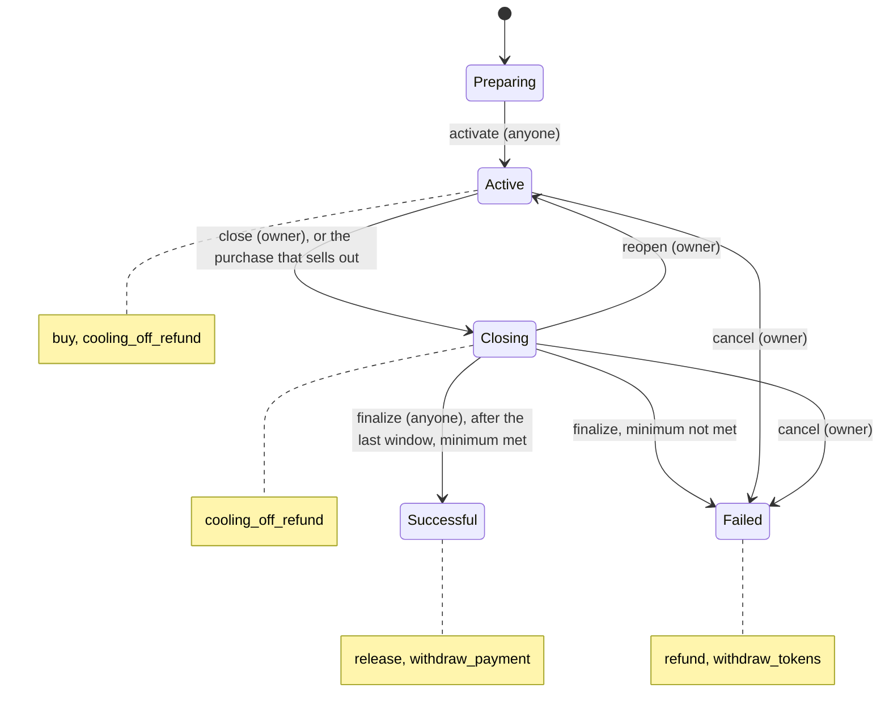

# offer-sale

- **What it does.** Runs the escrow and lifecycle of one offering. It holds the offering's whole token supply, minted to it by the token, and the investors' money. An investor buys with the payment asset and gets a reservation: tokens held for them, purchase by purchase. Buying stops when the tokenizer closes or the last token sells; the offering waits in Closing until every purchase's cooling-off window has run out; then anyone finalizes it, Successful if the minimum held and Failed otherwise. After success, tokens are released and the tokenizer withdraws; after failure, everyone is refunded.
- **Scope.** One instance per offering, deployed at an address computed from the deployer and the offering identifier, where the token already minted the supply.
- **Who uses it.** Investors call `buy` and `cooling_off_refund`. The tokenizer's treasury (the owner) closes, reopens and cancels, withdraws, pauses and unpauses. Anyone, in practice the backend, activates, finalizes, and runs `release` and `refund` in batches. The platform multisig pauses and upgrades.
- **Where it comes from.** A port of Base's `OfferTokenSale` with the moment of truth moved: Base declares an offering Successful while investors can still undo purchases, and patches the consequences by hand (the audits' SCAN-01 and NF-04, and a success that can stop being true). Here success is declared only once nothing can be undone, so those three cannot occur. Cooling-off is per purchase, the unsold tokens are burned, and the sale has a pause.

**Delivered in L4 (interface v1.0).** Testnet deployment: [`deployments/testnet.json`](../deployments/testnet.json), offering `l4-demo-1`. The cross-cutting rules are in [interface.md](interface.md).

## States

Every transition emits `state_changed`. The only step back is Closing → Active, by the owner's `reopen`.

**Why Closing.** Each purchase gives its investor a window (5 days in BWB's offerings) to undo it. Base calls the offering Successful the moment the owner finalizes, while windows are still open, so release has to wait per investor, withdrawals have to be capped, and a refund after finalize can leave an offering below its minimum and still Successful. Here `finalize` is refused until `now > last purchase + cooling_off_secs`, so in Successful no refund is possible: release is immediate and open to anyone, the owner withdraws freely, and the burn of the unsold tokens is exact. The price is the same as under the capped alternative: the tokenizer and the issuer are paid `cooling_off_secs` after the last purchase. A refund during Closing that drops the offering below its minimum leaves the state as it is; the owner reopens, cancels, or lets `finalize` fail it. These are decisions for the team to confirm, listed in [interface 11](interface.md#11-open-points).

## Powers

Three powers, each a stored address fixed at construction with no setter, as on the token (ADR 0005). Changing a holder takes an upgrade; a treasury rotates its officers without changing its address.

| Power | Held by | Can |
|---|---|---|
| `owner` | Tokenizer's treasury | `close`, `reopen`, `cancel`, `withdraw_payment`, `withdraw_tokens`, `pause`, `unpause` |
| `pauser` | Platform multisig | `pause` only, never `unpause` |
| `upgrader` | Platform multisig | `upgrade`. The trust root: a code swap can do anything |

A signed but wrong caller fails with the power's own code (6222–6224); a missing signature fails as `Error(Auth, InvalidAction)`. The contract doesn't know which party is which; the deploy passes the accounts.

## Constructor

`__constructor(power_holders, contracts, config)`, three structs so the CLI names every field:

| Argument | Meaning |
|---|---|
| `power_holders` | `{owner, pauser, upgrader}` |
| `contracts` | `{token, payment_asset, allowlist}`: the offering's `offer-token`, the SEP-41 asset investors pay with (USDC in production), the global `offer-allowlist` |
| `config.price` | Base units of the payment asset per token. Positive. |
| `config.cooling_off_secs` | The window of each purchase, in seconds. At least 86,400 (one day); Base's factory enforced the same, and BWB's offerings use 5 days. |
| `config.min_success_percent` | Share of the supply that must be sold for the offering to succeed, 10 to 100; 75 in BWB's offerings. |

Arguments outside the limits fail with 6216. There is no hard cap: with a fixed price and a fixed supply the most an offering can raise is `supply × price`, which is what Base's factory set the hard cap to. The construction emits `configured`.

## Reservation

One persistent entry per investor with something reserved:

| Field | Meaning |
|---|---|
| `schema` | Struct version, 1 |
| `tokens`, `paid` | The investor's totals across live purchases |
| `purchases` | Each live purchase under its allowlist receipt number: `{tokens, paid, at}`, `at` the ledger time of the purchase |

A purchase leaves the reservation on cooling-off, release or refund; the entry is removed once nothing is left. **An investor holds at most 20 live purchases per offering** (`MAX_PURCHASES`, 6220): a failed offering refunds the investor whole, one `allocation_restored` (292 B) per purchase, so the cap keeps one investor's refund far inside a transaction's 16 KB of events, and it equals the allowlist's `restore` limit, so a cooling-off refund never needs more than one call there. The allowlist's own cap of 100 receipts stays as the outer bound.

## Totals

| Total | Meaning |
|---|---|
| `supply` | The token's supply when the offering was activated: the tokens for sale. 0 before. |
| `sold_tokens` | Tokens reserved, net of refunds. The success check compares it with `supply`. |
| `raised` | Payment received, net of refunds. Withdrawals don't reduce it. |
| `released_tokens` | Tokens delivered by `release` |
| `withdrawn` | Payment taken by `withdraw_payment`. `withdrawable = raised − withdrawn` in Successful. |

Success means `sold_tokens × 100 ≥ supply × min_success_percent`, checked once, at `finalize`, when nothing can change it anymore.

## Calls

Every write that names its acting account takes it as the **last** argument (`caller`, or `operator` on `upgrade`), as the token's calls do, and requires its signature before checking the power. `buy` and `cooling_off_refund` take the investor, who authorizes. The open calls (`activate`, `finalize`, `release`, `refund`) take no account and need no authorization at all: the sale contract's own transfers, burn and allowlist calls are authorized by it as the direct caller, with no entry.

| Call | Authorized by | State | Effect |
|---|---|---|---|
| `activate()` | anyone | Preparing (6200) | Checks the sale contract holds the token's whole supply (6204) and `sale` on the allowlist (6219), keeps the supply as the tokens for sale, moves to Active. Runs after the token's deploy and the role grant. Emits `state_changed`, `activated`. |
| `buy(investor, amount)` | `investor` | Active (6201), not paused (1000) | `amount` must be positive (6205) and buy no more than the tokens left (6207); the investor may hold at most 20 live purchases here (6220). Pulls `amount` of the payment asset, measures what arrived, which must be positive (6209) and an exact multiple of the price (6206), and reserves `arrived / price` tokens. Uses that much allowlist room (`consume`; 6100, 6101, 6107 surface) and keeps the purchase under the receipt number. The purchase that sells the last token closes buying. Emits `purchased`; `closed` and `state_changed` on a sell-out. |
| `close(caller)` | owner | Active (6201) | Stops buying: → Closing. Emits `closed` (reason `owner`), `state_changed`. |
| `reopen(caller)` | owner | Closing (6221) | Opens buying again: → Active. For a refund that dropped the offering below its minimum. Emits `state_changed`, `reopened`. |
| `cancel(caller)` | owner | Active or Closing (6225) | → Failed, at the owner's decision; everyone is then refunded. Emits `state_changed`, `cancelled`. |
| `finalize()` | anyone | Closing (6221) | Refused while any window is open: `now ≤ last purchase + cooling_off_secs` (6214). Successful when the minimum held: the sale contract must still hold every sold token (6217; `xfer_admin` can move them), it burns the rest, and moves. Failed otherwise. Emits `finalized {burned}` or `finalized_failed`, then `state_changed`. |
| `cooling_off_refund(investor)` | `investor` | Active or Closing (6225) | Returns every purchase whose window is still open (`now ≤ at + cooling_off_secs`), whole purchases only. No reservation (6213) or no purchase still open (6212) fails. The receipts go back to the allowlist in one `restore`, the payment goes back, the totals fall; the reservation ends when nothing is left. Emits `refunded` (reason `cooling_off`). |
| `release(investors)` | anyone | Successful (6202), not paused (1000) | At most 30 (6215). Each investor listed with a reservation gets their tokens; the reservation ends. An investor with nothing reserved, or listed twice, is skipped. A failed token transfer fails the whole call. Emits `released` per investor served. |
| `refund(investors)` | anyone | Failed (6203) | At most 16 investors (6215), and at most 48 event units: 2 per investor served plus 1 per live purchase, checked before any transfer (6215). Each investor listed with a reservation gets their payment back and every receipt restored (`restore_all`); the reservation ends. An investor with nothing reserved is skipped. A failed payment transfer fails the whole call. Emits `refunded` (reason `failed`) per investor served. |
| `withdraw_payment(payouts, caller)` | owner | Successful (6202), not paused (1000) | Pays every `{recipient, amount}`, at most 30 (6215); each positive (6205), the total at most `raised − withdrawn` (6218). Emits `payment_withdrawn` per leg. |
| `withdraw_tokens(to, amount, caller)` | owner | Failed (6203), not paused (1000) | Sends tokens to `to`; `amount` positive (6205), within the balance (the token's 100). Emits `tokens_withdrawn`. |
| `pause(caller)` | owner or pauser | any | Blocks `buy`, `release`, `withdraw_payment` and `withdraw_tokens`: everything that moves value toward the tokenizer. Never `cooling_off_refund`, `refund`, `finalize`, `cancel`, `close` or `reopen`. Emits `paused`, `pause_changed`. Pausing a paused sale fails with 1000. |
| `unpause(caller)` | owner | any | Emits `unpaused`, `pause_changed`. Unpausing a live sale fails with 1001. |
| `upgrade(new_wasm_hash, operator)` | `operator` = upgrader | any | Replaces the code once the call succeeds (6224 for anyone else). Storage is kept; the constructor does not run again. No `migrate` in this version. |

Read functions, the backend's read path:

| Call | Returns |
|---|---|
| `state()` | `Preparing`, `Active`, `Closing`, `Successful` or `Failed` |
| `config()`, `powers()`, `contracts()` | The constructor's three structs |
| `totals()` | The five totals |
| `reservation(investor)` | The reservation, or void |
| `finalizable_at()` | The ledger time from which `finalize` passes its window check: `last purchase + cooling_off_secs + 1`. 0 before any purchase. The app's countdown. |
| `withdrawable()` | `raised − withdrawn` in Successful, else 0. The payout is computed from it. |
| `preview_tokens(amount)` | `amount / price`; fails (6206) on a non-multiple |
| `paused()`, `schema_version()` | OpenZeppelin's flag; 1 |

The reads extend nothing. The code version is in the WASM metadata as `binver` (SEP-46, SEP-49): `stellar contract info meta`.

**Batch rules.** `release` and `withdraw_payment` are bound by events: 30 investors emit 10,680 B (token `transfer` 168 B + `released` 188 B each), 30 legs 12,360 B (payment `transfer` 244 B + `payment_withdrawn` 168 B each), of a transaction's 16,384 B. `refund` carries one `allocation_restored` (292 B) per purchase on top of the payment `transfer` (244 B) and `refunded` (296 B), so it is bound in units of one 292 B event: an investor served costs 2, each live purchase 1, and a call may spend 48, at most 14,016 B; the hard cap of 16 investors is the cheap pre-check. Tests pin the sizes and measure full batches under the documented network limits (200 write entries, 400 footprint entries, [interface R7](interface.md#r7-network-limits)); a full refund writes about 66 entries, a full release 62. The backend sizes every batch by simulation anyway: the contract's limits are upper bounds, and the SDK's bundled table of mainnet limits says 50 write entries, under which a refund fits about 12 one-purchase investors ([interface 12](interface.md#12-risks)).

**Who is in a batch.** The investors to release or refund are those with a reservation on chain (`purchased` events), not only the backend's confirmed orders; an on-chain buyer missing from the backend's list is never served. Investors with nothing reserved are skipped, so a stale list is harmless; an investor whose payment transfer fails (a frozen balance, SAC 11; a dropped trustline, 13) fails the whole call, and the backend leaves them out and retries the rest.

## Differences from Base

- **A Closing state, and success only after the last window.** Base: `finalizeSale` moves to Successful at once; `releaseTokens` has no access control and zeroes the position, so a third party can end a cooling-off (SCAN-01); `withdrawBrla` can empty the escrow while refunds are still owed (NF-04, accepted); a refund after finalize can leave the offering below its minimum and Successful. Here none of the three can happen. The team is asked to confirm the shape ([interface 11](interface.md#11-open-points)).
- **Buying can close by itself.** The purchase that sells the last token moves to Closing; Base keeps a sold-out offering Active until the owner finalizes.
- **`finalize` decides, and anyone calls it.** It replaces `finalizeSale` and `markSaleFailed`: the outcome is a fact once the windows have run out, so no signing ceremony is needed. `cancel` (Base's `enableRefunds`) stays the owner's, and also works in Closing.
- **`reopen`.** New: the owner's way out of a near-miss without failing the offering.
- **Unsold tokens are burned at finalize** (provisional, pending the team's legal answer; the alternative is sending them to the issuer, a one-line change). In Base they stay in the contract after success (SCAN-02) and would take a share of every distribution. The token gained a `burn` that only its initial holder may call.
- **Cooling-off per purchase**, whole purchases, in Active and Closing. Base counted one window from the last purchase and allowed it in Successful.
- **`buy` keeps Base's shape:** money in, measured on arrival, an exact multiple of the price. No hard cap: `supply × price` is the ceiling.
- **Refunds restore through `restore_all`**, one call per investor, and the batch is sized in event units; an investor holds at most 20 live purchases.
- **Pause is new.** Base's sale has none; the platform can pause, only the tokenizer unpauses (ADR 0003, flagged for the team), and what a paused sale blocks is the money toward the tokenizer, never the investor's exit.
- **Powers are stored addresses**, like the token's, instead of `Ownable` plus roles.
- **`withdraw_payment` takes every payout at once**, replacing several `withdrawBrla` calls in one Safe batch.
- **Removed:** `inventoryProvider`, `seedInventory` and `updateInventoryProvider` (the token mints to the sale's address, ADR 0006); the flags `isFinalized`, `refundsEnabled`, `inventorySeeded`, which `state` covers; `version()`, replaced by `schema_version` and `binver`; the hard cap.

## Events

Data fields are listed in sorted name order. Symbols: `reason` is `owner` | `sold_out` on `closed` and `cooling_off` | `failed` on `refunded`; `from` and `to` on `state_changed` are `preparing`, `active`, `closing`, `successful`, `failed`.

| Event | Topics | Data | When |
|---|---|---|---|
| `configured` | `configured` | `{allowlist, cooling_off_secs, min_success_percent, owner, pauser, payment_asset, price, token, upgrader}` | Construction |
| `state_changed` | `state_changed` | `{from, to}` | Every transition |
| `activated` | `activated` | `{supply}` | `activate`, after `state_changed` |
| `purchased` | `purchased`, investor | `{at, paid, raised, receipt, reserved_paid, reserved_tokens, sold_tokens, tokens}` | `buy`. `paid` and `tokens` are this purchase; `reserved_*` the investor's totals afterwards; `raised` and `sold_tokens` the offering's. |
| `closed` | `closed` | `{raised, reason, sold_tokens}` | `close`, and the purchase that sells out; before `state_changed` |
| `reopened` | `reopened` | `{raised, sold_tokens}` | `reopen`, after `state_changed` |
| `cancelled` | `cancelled` | `{raised, sold_tokens}` | `cancel`, after `state_changed` |
| `finalized` | `finalized` | `{burned, raised, sold_tokens}` | `finalize` toward Successful, before `state_changed` |
| `finalized_failed` | `finalized_failed` | `{min_success_percent, raised, sold_tokens}` | `finalize` toward Failed, before `state_changed` |
| `released` | `released`, investor | `{paid, tokens}` | `release`, per investor served |
| `refunded` | `refunded`, investor | `{paid, raised, reason, sold_tokens, tokens}` | `cooling_off_refund` and `refund`, per investor served. `raised` and `sold_tokens` are the totals afterwards. |
| `payment_withdrawn` | `payment_withdrawn`, recipient | `{amount}` | `withdraw_payment`, per leg |
| `tokens_withdrawn` | `tokens_withdrawn`, to | `{amount}` | `withdraw_tokens` |
| `pause_changed` | `pause_changed`, caller | `{paused}` | `pause` and `unpause`, after OpenZeppelin's |
| `upgraded` | `upgraded` | `{from_schema_version, new_wasm_hash}` | `upgrade`, emitted by the old code |

The totals on `purchased` and `refunded` let an indexer rebuild the offering's state from any later event. Also emitted, by the contracts the sale calls: the allowlist's `allocation_consumed` (before `purchased`) and `allocation_restored` (before `refunded`, one per receipt); the token's `transfer` on release and withdrawal and `burn` on finalize; the payment asset's `transfer` on every purchase, refund and payout; OpenZeppelin's `paused` / `unpaused`.

**Sizes.** Measured XDR encodings, pinned by a test: `released` 188 B, `refunded` 300 B (`cooling_off`; 296 B with `failed`), `payment_withdrawn` 168 B, `purchased` 404 B. The batch arithmetic is under [Calls](#calls).

## Errors

| Code | Name | When |
|---|---|---|
| 6200 | `NotPreparing` | `activate` outside Preparing |
| 6201 | `NotActive` | `buy` or `close` outside Active |
| 6202 | `NotSuccessful` | `release` or `withdraw_payment` outside Successful |
| 6203 | `NotFailed` | `refund` or `withdraw_tokens` outside Failed |
| 6204 | `InventoryMissing` | `activate` while the sale contract does not hold the whole supply |
| 6205 | `NonPositiveAmount` | A purchase, a payout leg or a token withdrawal of zero or less |
| 6206 | `NotWholeTokens` | What arrived for a purchase is not an exact multiple of the price; `preview_tokens` of a non-multiple |
| 6207 | `ExceedsSupply` | A purchase beyond the tokens left |
| 6209 | `NothingReceived` | No payment arrived for a purchase |
| 6212 | `CoolingOffClosed` | `cooling_off_refund` with no purchase still inside its window |
| 6213 | `NothingReserved` | `cooling_off_refund` by an investor with nothing reserved |
| 6214 | `CoolingOffOpen` | `finalize` while a window is still open |
| 6215 | `BatchTooLarge` | More than 30 in `release`, 30 legs in `withdraw_payment`, 16 investors or 48 units in `refund` |
| 6216 | `InvalidConfig` | A constructor argument outside its limits |
| 6217 | `TokensMissing` | `finalize` toward Successful while the sale contract holds fewer tokens than it sold |
| 6218 | `ExceedsWithdrawable` | `withdraw_payment` beyond `raised − withdrawn` |
| 6219 | `NotSale` | `activate` before the sale contract holds `sale` on the allowlist |
| 6220 | `TooManyPurchases` | A purchase by an investor already holding 20 live purchases here |
| 6221 | `NotClosing` | `finalize` or `reopen` outside Closing |
| 6222 | `NotOwner` | A signed caller that is not `owner` |
| 6223 | `NotPauser` | A signed caller that is neither `pauser` nor `owner`, on `pause` |
| 6224 | `NotUpgrader` | A signed caller that is not `upgrader` |
| 6225 | `NotOpen` | `cancel` or `cooling_off_refund` once the offering is decided, or before it is activated |

6208, 6210 and 6211 are unused: the hard cap and `mark_failed` of the draft are gone.

Codes from the contracts it calls, which surface unchanged:

- **allowlist:** 6100 `InvestorNotEnabled`, 6101 `AllocationExceeded` and 6107 `TooManyReceipts` during `buy`; 6103 `ReceiptNotFound` during a refund can only be a bug in the sale contract; 2000 `Unauthorized` on `buy` if the sale contract's `sale` role was revoked (its refunds keep working);
- **token:** 100 `InsufficientBalance` on a token withdrawal beyond the balance; 1000 `EnforcedPause` on `release`, `withdraw_tokens` and the burn inside `finalize` while the token is paused; 6000 if the sale contract were removed from the token's whitelist;
- **payment asset** (a Stellar Asset Contract), during a purchase, refund or payout: 10 `BalanceError`, 11 `BalanceDeauthorizedError` (Circle can freeze an investor's balance and the sale contract's own escrow), 13 `TrustlineMissingError` ([interface R6](interface.md#r6-error-codes));
- **OpenZeppelin:** 1000 `EnforcedPause` and 1001 `ExpectedPause` from the sale's own pause.

The sale never returns 2000 or 2007 itself: a signed but wrong caller gets the power's own code. A missing signature fails as `Error(Auth, InvalidAction)`, not as a contract code ([interface 7.1](interface.md#71-codes)).

## Storage and expiry

- Reservations: one persistent entry per investor with something reserved, written by `buy` and `cooling_off_refund`, removed by `release`, `refund` and a cooling-off refund that empties it. At most 20 live purchases; about 1.7 KB at 20.
- Powers, contracts, terms, state, totals and the latest purchase's time: instance, with OpenZeppelin's pause flag and schema version.

**Policy.** Every state-changing call tops the instance up to the network maximum once it falls a month below it, and `buy` and `cooling_off_refund` do the same for the reservation they write, so a quiet offering (Closing for five days, Successful with late releases, Failed with late refunds) does not archive between touches. The reads extend nothing. The token and the allowlist keep their own entries alive: the sale contract's token balance on every transfer and burn, its `sale` role on every consume and restore. An archived reservation is not gone: the call that touches it restores it, so a late release or refund works provided the submitter simulates it afresh ([interface 9](interface.md#9-storage-and-expiry)).

## Tests

`scripts/test.sh` builds the upgrade fixtures and runs the tests; CI runs the same script. One seam: the contract client in the Soroban test environment, beside the real `offer-allowlist` and `offer-token` (dev-dependencies) and a Stellar Asset Contract as the payment asset, with the ledger time pinned per test. The modules follow the D2 vocabulary:

| Module | Covers |
|---|---|
| `state` | Every transition: activate (and its two checks), close by the owner and by a sell-out, reopen, cancel from Active and from Closing, finalize at the window boundary, at exactly the minimum, below it, with everything sold, with sold tokens missing; every state rejection; release, refund, payout and token withdrawal in their states; `finalizable_at`; a refund below the minimum during Closing, then reopen and success |
| `authorization` | A signed wrong caller per privileged call gets the power's code; an unsigned call fails at authorization (every privileged call, `buy` and `cooling_off_refund`); activate, finalize, release and refund with no auths at all, the burn and the transfers inside them included; exact-signer positives, the investor's purchase tree with the payment sub-call among them; nobody refunds in an investor's name |
| `boundary` | Price multiples and non-positive amounts; the last token and one more; 20 purchases and the 21st, freed by a cooling-off; 30 and 31 for release and payouts, 16 and 17 for refunds; the unit budget (47 fits, 50 does not) checked before any transfer; full release, refund and payout batches measured under the documented network limits; a payment asset that keeps a fee (credits what arrived; nothing arrived) |
| `cooling_off` | Inside the window, at its last second, after it; only the purchases still in their window come back; a purchase charged to one month undone in the next gives that month's room back; in Closing; nothing reserved; after the offering is decided; after release; 20 purchases in one call; a second request with nothing left |
| `idempotency` | Release and refund twice and with duplicates; a never-buyer skipped; close, reopen, close; every read agrees with the writes |
| `pause` | A paused sale blocks `buy`, `release`, the withdrawals, never cooling-off, refunds, close, reopen, cancel or finalize; a paused token blocks release and the burn inside finalize; OpenZeppelin's 1000 and 1001 |
| `failure` | The constructor's limits (6216) and the limits themselves; 6100 and 6101 surfacing through `buy`; an unfunded investor failing in the payment asset; a balance frozen by the asset's issuer failing the whole refund batch, and the batch passing once unfrozen; payout and withdrawal amounts; a refund batch pays everyone whole |
| `events` | Exact events and order for construction, activate, buy, the sell-out, close, reopen, cancel, both finalizes, release, both refunds, payouts, pause and token withdrawal; the measured sizes |
| `upgrade` | Swap to `offer-sale-upgrade-fixture`, a test-only second binary, with the exact `upgraded` event; state, totals, terms, powers, contracts, the latest purchase's time, two investors' reservations with their purchases, the pause flag and `schema_version` survive; the upgraded code can upgrade again under the same gate; a hash never uploaded fails; a non-upgrader cannot swap |
| `ttl` | The instance on construction, after a quiet month, on the owner's calls and finalize; the reservation on purchase and on a partial refund; reads extend nothing |
