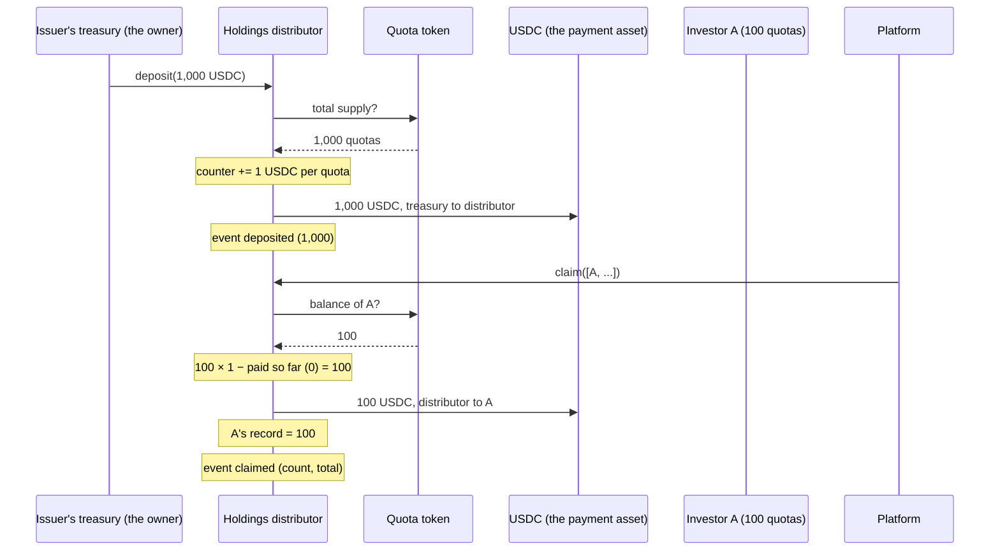

# offer-holdings-distributor

- **What it does.** Pays an offering's returns to whoever holds its quotas. The owner deposits money; each holder's share is its quota balance times what one quota has earned, less what the holder was already paid. The share leaves the contract in a claim, which anyone may send for a list of up to 50 holders.
- **Scope.** One instance per offering, tied at construction to the offering's token and to one payment asset.
- **Who uses it.** The owner, the issuer's treasury, deposits, withdraws, pauses and unpauses. The platform relays the claims after each deposit and reads the events. The platform multisig pauses and upgrades.
- **Where it comes from.** A port of Base's `TokenDistributorByHoldings`, following it wherever Stellar allows ([Differences from Base](#differences-from-base)).

**Delivered in L7.** Testnet deployment: [`deployments/testnet.json`](../deployments/testnet.json), offering `t1-demo-4`; `scripts/demo-offer-holdings-distributor.sh` exercises it. The design decisions are on issue [#29](https://github.com/BWB-Labs/bwb-stellar/issues/29). The cross-cutting rules are in [interface.md](interface.md). The other distributor, [`offer-distributor`](offer-distributor.md), pays a list the owner writes and holds no balance; this one works out each share from the token and holds the money until it is claimed.

## A deposit and its claims



- **A deposit touches no holder.** It raises one counter, what a single quota has earned from every deposit so far, by `amount ÷ total supply`. The cost of a deposit does not grow with the number of holders.
- **A share is worked out when it is claimed.** `balance × counter − paid so far`. A holder who skipped three deposits gets all three in one claim; a second claim with nothing new pays nothing.
- **Anyone sends a claim; the holder gets the money.** Nobody signs. The sender gains nothing, so the platform relays claims for every holder without holding any key of theirs.
- **The supply of the moment.** Each deposit is divided among the quotas that exist when it arrives. Quotas burned before a deposit take no part of it.
- **Rounding goes down.** The counter is kept times 10^18 and every division rounds down, so the contract never owes more than it holds. What the divisions leave, at most a few stroops per deposit, stays in the contract.

## Who cannot be paid

A claim passes over a holder in three cases, and the rest of the list is paid:

| Case | What happens |
|---|---|
| Nothing to receive | Passed over, no event |
| The holder is on the token's whitelist | `claim_skipped`, nothing paid |
| The payment asset refuses the transfer | `claim_skipped`, nothing paid |

- **Whitelisted accounts are operational accounts**: the sale contract, a treasury that took quotas back. The sale can only pay out what it raised, so return money sent to it would be stuck; and a quota it later releases would be paid a second time in its investor's hands. With the refusal, the share of quotas held by a whitelisted account waits in the distributor. A deposit made before every `release` is therefore safe: the investor claims the share after receiving the quotas.
- **A refused transfer** is a holder without a trustline for the payment asset, one whose balance the asset's issuer froze, or a claim the distributor cannot afford because the owner withdrew the money. The holder's record does not change, so the same share is paid by a later claim once the cause is gone.
- **The backend reads `claim_skipped`** to know who was left out, and retries later.

Quotas a whitelisted account keeps for good still count in the supply, so their share of each deposit accumulates. The owner takes it out with `withdraw`, or the quotas are burned before the deposit.

## Accepted risk: quotas that move after a claim

"Paid so far" is recorded per account and the balance is read when the claim runs. If quotas move after their holder claimed, the receiver's record knows nothing of that payment, and the receiver can claim for them again. The second payment comes out of the other holders' money, and the last claimants find the contract short. Base behaves the same way (its audit's NF-03).

What limits it on Stellar:

- An investor cannot transfer quotas to another investor, only to a whitelisted account, and those cannot claim.
- What remains is the token's forced transfer (`admin_transfer`), signed by the token's transfer admin.

**Operating rule.** After an offering's first deposit, no forced transfer without first checking both accounts: `claimable` for the sender should be zero (claim for it first), and the receiver's `credited` is compared with what its new balance will earn. A test pins the behaviour (`quotas_moved_after_a_claim_are_paid_again`).

Removing the risk at the root, by paying from balances read in the same call as the deposit, is recorded as a future change on [#59](https://github.com/BWB-Labs/bwb-stellar/issues/59).

## Powers

Three powers, each a stored address fixed at construction with no setter, as on the other contracts (ADR 0005). Changing a holder takes an upgrade; a treasury rotates its officers without changing its address.

| Power | Held by | Can |
|---|---|---|
| `owner` | the issuer's treasury | `deposit`, `withdraw`, `pause`, `unpause` |
| `pauser` | platform multisig | `pause` only |
| `upgrader` | platform multisig | `upgrade` |

The owner is the issuer, not the tokenizer: the return money leaves the issuer's account and goes into the distributor, and a withdrawal goes back to the issuer. The platform never holds it. This is the one contract where the issuer has a role.

A paused distributor blocks `deposit` and `claim`. `withdraw` and the reads keep working. The platform can pause but only the owner unpauses.

## Constructor

```
__constructor(power_holders: {owner, pauser, upgrader}, contracts: {token, payment_asset})
```

Stores both and emits `configured`. Neither can be changed later. The counter is one number, so the distributor works in one payment asset for its whole life.

## Calls

| Call | Who | What |
|---|---|---|
| `deposit(amount, caller)` | owner | Takes `amount` of the payment asset from the owner's account and raises the counter. Refuses an amount that is not positive (6405), a token with no supply (6406) and an amount too large for the counter (6407). Blocked while paused |
| `claim(holders)` | anyone | Pays each of 1 to 50 holders (6403, 6404) its share, passing over those it cannot pay. Blocked while paused |
| `withdraw(asset, amount, caller)` | owner | Sends `amount` of any asset from the distributor's balance to the owner's own account. Refuses an amount that is not positive (6405). Works while paused |
| `pause(caller)` | owner or pauser | Blocks `deposit` and `claim` |
| `unpause(caller)` | owner | Resumes |
| `upgrade(new_wasm_hash, operator)` | upgrader | Replaces the code; storage is kept |

Reads, none of which needs a signature or extends an entry's lifetime:

| Read | Answers |
|---|---|
| `claimable(holder)` | What a claim would try to pay the holder now; zero for a whitelisted account |
| `credited(holder)` | What the holder was paid so far |
| `cumulative_per_quota()` | The counter: what one quota has earned, times 10^18 |
| `contracts()` | `{token, payment_asset}` |
| `powers()` | `{owner, pauser, upgrader}` |
| `paused()`, `schema_version()` | The pause flag; the storage layout version, 1 |

### Withdrawing

`withdraw` has no recipient: the money can only go to the owner's own account. `asset` is free, so a token sent to the distributor by mistake leaves the same way.

On the payment asset, a withdrawal can take money holders have not claimed yet, as Base's `withdrawTokens` can. The contract does not try to tell the claimable part from the rest: what is owed to accounts that cannot claim changes with every transfer of quotas. No holder's record changes, so what was earned is still owed, and claims are skipped until the money is back. The issuer is trusted with this the same way it is trusted to deposit at all.

### Authorization

- **`deposit`**: the owner signs the call and the one `transfer` the payment asset makes in its name, for this amount, to the distributor. A signature for one amount does not pay another.
- **`withdraw`, `pause`, `unpause`, `upgrade`**: the holder signs the call alone. A withdrawal pays from the distributor's own balance, so the owner authorizes no transfer.
- **`claim`**: no signature.

## Batch size

A claim takes at most 50 holders. The limit that binds is the 16,384 B of events a transaction may emit: each paid holder costs the payment asset's own `transfer` event, 244 B for USDC to a classic account. A full claim, measured by a test:

| Resource | A claim of 50 | Network limit |
|---|---|---|
| Events | 12,340 B with USDC | 16,384 B |
| Write entries | 101 (a trustline and a record per holder, and the distributor's balance) | 200 |
| Footprint entries | 205 | 400 |

50 is a cap, not a promise. A list that does not fit fails whole in simulation, before anything is sent, and the sender splits it. 120 holders are three calls.

## Differences from Base

| Base (`TokenDistributorByHoldings`) | Here | Why |
|---|---|---|
| `distribute(payer, amount)` | `deposit(amount, caller)` | The payer was always the owner; the name says what the call does |
| `claim()`, `claimFor(holder)`, `claimMany(holders)` | `claim(holders)` | With no signature from the holder the three are one operation |
| Any holder can claim | A whitelisted account cannot | Money claimed to the sale would be stuck, and its quotas paid twice |
| One failing holder reverts `claimMany` | The holder is skipped with `claim_skipped` | A batch keeps moving and the backend learns who was left out |
| `withdrawTokens(token, recipient)` sends the whole balance anywhere | `withdraw(asset, amount, caller)` pays only the owner | A mistaken or coerced withdrawal lands in the issuer's treasury |
| No pause, no upgrade | Both, as on the other contracts | |
| Storage never expires | Each record is persistent and renewed on claim | [Storage and expiry](#storage-and-expiry) |

The same on both: the counter and its 10^18 magnitude, the per-account record, claims open to anyone, and the accepted risk above.

## Events

Data fields are listed in sorted name order.

| Event | Topics | Data | When |
|---|---|---|---|
| `configured` | `configured` | `{owner, pauser, payment_asset, token, upgrader}` | Construction |
| `deposited` | `deposited` | `{amount}` | `deposit`, after the asset's `transfer` |
| `claim_skipped` | `claim_skipped`, holder | `{}` | `claim`, per holder it could not pay |
| `claimed` | `claimed` | `{count, total}` | `claim`, once, after the payments |
| `withdrawn` | `withdrawn`, asset | `{amount}` | `withdraw`, after the asset's `transfer` |
| `pause_changed` | `pause_changed`, caller | `{paused}` | `pause` and `unpause`, after OpenZeppelin's |
| `upgraded` | `upgraded` | `{from_schema_version, new_wasm_hash}` | `upgrade`, emitted by the old code |

Also emitted, by the payment asset: one `transfer` from the owner to the distributor before `deposited`, one from the distributor to each paid holder during a claim, and one from the distributor to the owner before `withdrawn`.

**Reading them.** A paid holder has no event of the distributor's: the asset's `transfer` from the distributor's address to the holder is the record of who received how much, and an indexer reads it. `claimed` closes each call with how many holders were paid and their sum; it is emitted even when nobody was paid. A refused call emits nothing.

**Sizes.** `claimed` is 140 B, pinned by the measuring test.

## Errors

| Code | Name | When |
|---|---|---|
| 6400 | `NotOwner` | A signed caller that is not `owner` |
| 6401 | `NotPauser` | A signed caller that is neither `pauser` nor `owner`, on `pause` |
| 6402 | `NotUpgrader` | A signed caller that is not `upgrader` |
| 6403 | `EmptyBatch` | A claim with no holders |
| 6404 | `BatchTooLarge` | More than 50 holders |
| 6405 | `NonPositiveAmount` | A deposit, or a withdrawal, of zero or less |
| 6406 | `NoSupply` | A deposit while the token has no supply |
| 6407 | `AmountOverflow` | A deposit too large for the counter, or a share too large for an `i128` |

Codes from the contracts it calls, which surface unchanged:

- **the payment asset** (a Stellar Asset Contract), during a deposit or a withdrawal: 10 `BalanceError` (the owner holds less than the deposit, or a withdrawal asks for more than the distributor holds), 11 `BalanceDeauthorizedError`, 13 `TrustlineMissingError` ([interface R6](interface.md#r6-error-codes)). In a claim these do not surface: the holder is skipped;
- **OpenZeppelin:** 1000 `EnforcedPause` and 1001 `ExpectedPause` from the distributor's own pause.

A missing signature fails as `Error(Auth, InvalidAction)`, not as a contract code ([interface 7.1](interface.md#71-codes)).

## Storage and expiry

- Each holder's "paid so far": one persistent entry, written when the holder is first paid and never removed.
- The counter, the powers and the two contracts: instance, with OpenZeppelin's pause flag and schema version.

**Policy.** Every state-changing call tops the instance up to the network maximum once it falls a month below it, and a claim writes each paid holder's entry with the maximum lifetime. The reads extend nothing.

**A record cannot read as zero again.** A persistent entry that runs out is archived, not deleted. A claim for that holder needs the entry restored first, which the transaction does and its sender pays for, and it comes back with the same value. There is no path by which a holder paid years ago looks unpaid.

## Tests

`scripts/test.sh` builds the upgrade fixtures and runs the tests; CI runs the same script. One seam: the contract client in the Soroban test environment, beside the real `offer-token` and a Stellar Asset Contract as the payment asset, revocable like Circle's USDC. The modules follow the D2 vocabulary:

| Module | Covers |
|---|---|
| `authorization` | A signed wrong caller per privileged call gets the power's code, a funded stranger included; an unsigned call fails at authorization; `claim` and the reads with no auths at all; the owner's exact authorization for a deposit with its one `transfer`; a signature for another amount is refused; a withdrawal is signed as the call alone |
| `deposit` | The money pulled and the counter raised; deposits add up; no holder is paid; zero and negative amounts; no supply; an amount too large for the counter; rounding down and the dust left; a deposit smaller than the supply; the supply of the moment |
| `claim` | Holders paid by what they hold; no signature; a second claim pays nothing; the difference after a new deposit; several deposits in one claim; a holder listed twice; an account with no quotas; a claim before any deposit; a holder who returned quotas after claiming; the accepted risk pinned; an empty list and 51 holders; a full list of 50 classic accounts measured against the network limits |
| `skip` | A whitelisted account is skipped with the event and paid nothing; a deposit before the quotas are handed out waits for the holder; an account taken off the whitelist claims; a holder without a trustline is skipped and paid once it has one; a frozen balance; a distributor the owner emptied |
| `withdraw` | Into the owner's own account with the exact event; nobody else; zero and negative amounts; more than the balance; no record changes; a stray asset; while paused |
| `pause` | A paused distributor blocks `deposit` and `claim` until the owner unpauses; the owner may pause too; the reads answer while paused; OpenZeppelin's 1000 and 1001 |
| `events` | Exact events and order for construction, a deposit, a claim with paid and skipped holders, a claim that pays nobody, pause and unpause |
| `upgrade` | Swap to `offer-holdings-distributor-upgrade-fixture`, a test-only second binary, with the exact `upgraded` event; the powers, the contracts, the counter, the records, the pause flag and `schema_version` survive; the upgraded code can upgrade again under the same gate; a hash never uploaded fails; neither the owner nor the pauser can swap; an upgrade tops the instance up |
| `ttl` | The instance on construction, after a quiet month and not before it, on a claim, a withdrawal, pause and unpause; a paid holder's record written with the maximum lifetime; reads extend nothing |
